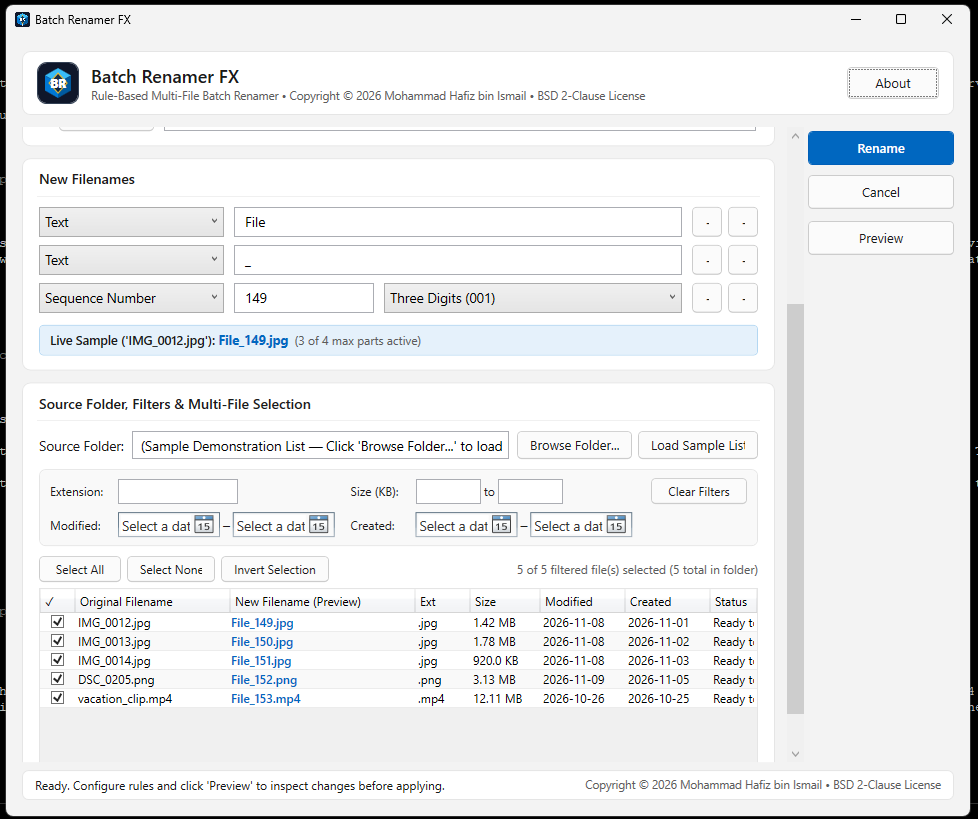
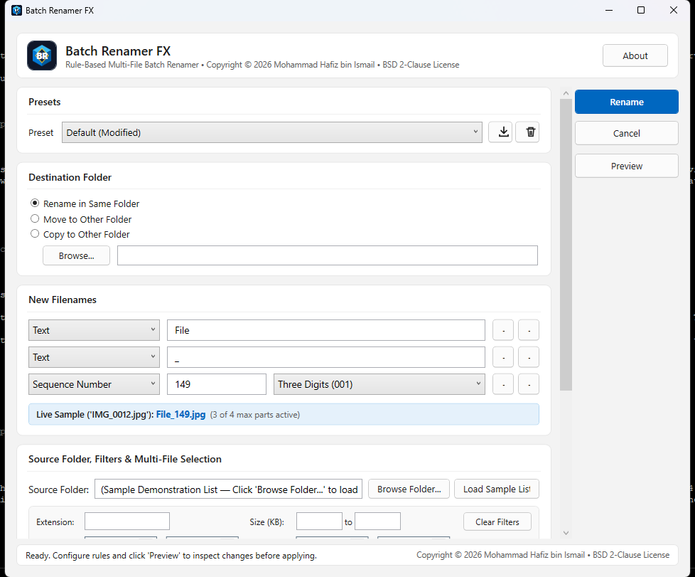

# Batch Renamer FX

Batch Renamer FX is a Windows desktop application designed for quickly batch renaming hundreds or thousands of files using configurable multi-part rules, multi-criteria filtering, and real-time change preview.

## Screenshots

## Features

- **Configurable Multi-Part Renaming Rules**:
  - Build custom naming patterns with up to 4 configurable rule parts using dynamic `+` and `−` controls.
  - **Text**: Constant prefix, suffix, or delimiter strings.
  - **Sequence Number**: Configurable start number and zero-padded digit length (e.g., `1` with 3 digits → `001`).
  - **Sequence Letter**: Alphabetical progression (`A`, `B`, `C`... or `a`, `b`, `c`...).
  - **Date**: Formats including ISO date (`YYYY-MM-DD`), `MMDDYYYY`, `YYYYMMDD`, `YYYYMM`, and `YYYY-MM`, using either a fixed reference date or each file's modification timestamp.
  - **Extension Preservation**: The original file extension is always preserved and appended automatically.

- **Real-Time & Dedicated Preview**:
  - Live preview banner updates instantly as rules are edited.
  - Dedicated **Preview Window** displays before-and-after filenames, destination paths, and collision checks before committing any file changes.

- **Flexible Destination Options**:
  - **Rename in Same Folder**: In-place rename within the source directory.
  - **Move to Other Folder**: Relocate and rename files in a chosen destination folder.
  - **Copy to Other Folder**: Duplicate files to a destination folder with new names while keeping source files untouched.

- **Preset Management**:
  - Built-in presets for common renaming conventions (`Default`, `Photo Sequence`, `Dated Mark`, `Appendix Letter`).
  - Automatic `(Modified)` state tracking when settings change.
  - Ability to save current rule configurations as custom presets and delete unwanted presets.

- **Advanced File Filtering & Selection**:
  - Filter source files by **Extension** (e.g., `.jpg, .png`), **File Size** (min/max KB), **Date Modified**, and **Date Created**.
  - Multi-file selection with bulk controls: **Select All**, **Select None**, and **Invert Selection**.

- **Modern Microsoft Fluent UI**:
  - Windows 11 Fluent Design styling with subtle cards, Communication Blue accents, and clear action button labeling.
  - Confirmation dialogs that prompt for user permission before executing any filesystem operations.

## Requirements

- **Operating System**: Windows 10 (version 1809 / build 17763 or later) or Windows 11.
- **Runtime Options**:
  - **.NET Framework Edition (`bin/Release/net48`)**: Requires Microsoft .NET Framework 4.8 or later.
  - **Windows Store / MSIX**: Compatible with the Windows Desktop Bridge (`Package.appxmanifest`).

## Credits

- **Author & Copyright**: Copyright © 2026 Mohammad Hafiz bin Ismail (mypapit@gmail.com).
- **Author's Website**: [https://mypapit.net](https://mypapit.net)
- **License**: Released under the [BSD 2-Clause License](LICENSE.txt).
- **GitHub Repository**: [https://github.com/mypapit/batchrenamerfx](https://github.com/mypapit/batchrenamerfx)

